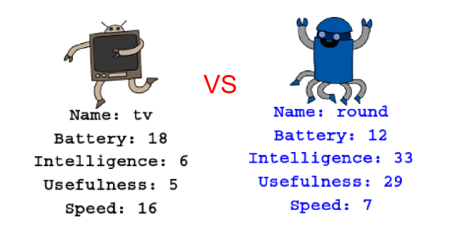

--- challenge ---

## Challenge: Play robot trumps with a friend

Share your project with a friend and play Robotrumps. Both use the same project so that it's fair! Player one requests a random robot and then chooses a category. Player 2 then requests a random robot and you check who has the highest score for the chosen category, then swap over. 

The game works best if you both play with the same deck of cards, so take turns on the same computer. 

--- /challenge ---